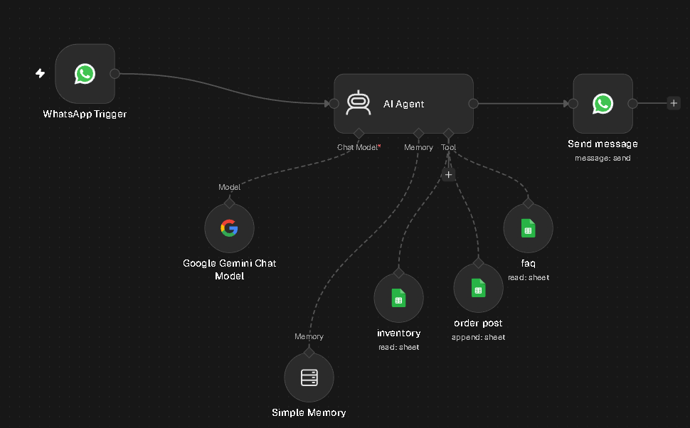
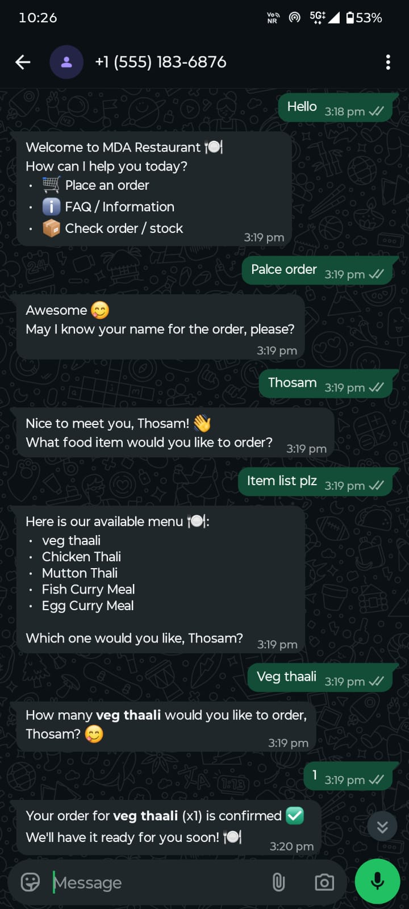
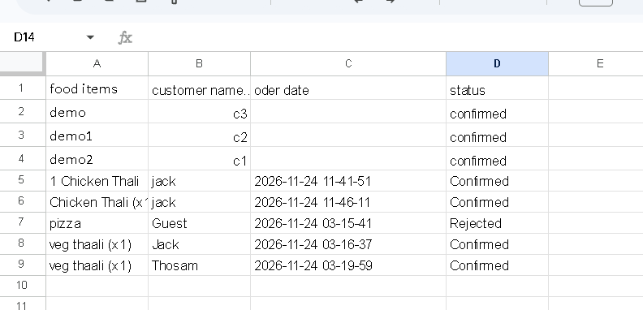

# AI Restaurant Management Chatbot 🍽️

An AI-powered restaurant ordering chatbot built using n8n, WhatsApp Cloud API, Google Gemini, and Google Sheets.

## 📌 Project Overview

This project automates restaurant customer interactions through WhatsApp. Customers can communicate with the chatbot to ask questions, check food availability, and place orders.

The chatbot uses Google Gemini to understand customer messages and Google Sheets to manage restaurant information and orders.

## ✨ Features

- **AI-Powered Chat:** Understands customer messages using Google Gemini.
- **WhatsApp Integration:** Receives and responds to customer messages through WhatsApp Cloud API.
- **FAQ Management:** Retrieves restaurant information from Google Sheets.
- **Inventory Management:** Checks food item availability using Google Sheets.
- **Order Management:** Stores customer orders in Google Sheets.
- **Conversation Memory:** Maintains conversational context using n8n Simple Memory.

## 🛠️ Technologies Used

- n8n – Workflow Automation
- WhatsApp Cloud API – Messaging Integration
- Google Gemini – AI Language Model
- Google Sheets – Data Storage
- Webhooks – Event-based Communication

## ⚙️ Workflow

1. Customer sends a message through WhatsApp.
2. WhatsApp Trigger receives the incoming message.
3. AI Agent processes the message using Google Gemini.
4. The AI Agent accesses FAQ and Inventory Google Sheets when required.
5. Customer orders are stored in the Orders Google Sheet.
6. The response is sent back through WhatsApp.

## 📊 Google Sheets Structure

The project uses three Google Sheets:

- **FAQ:** Restaurant information and frequently asked questions.
- **Inventory:** Food items and their availability.
- **Orders:** Customer order records.

## 🚀 Setup Instructions

1. Import the workflow JSON into n8n.
2. Configure WhatsApp Cloud API credentials.
3. Configure Google Gemini API credentials.
4. Connect your Google Sheets account.
5. Replace the placeholder Spreadsheet ID and WhatsApp Phone Number ID with your own values.
6. Configure the required WhatsApp webhook and activate the workflow.

**Note:** API credentials, access tokens, and private configuration values are not included in this repository.

## 📷 Screenshots

Screenshots of the workflow and chatbot interactions will be added here.

### 1. Workflow Architecture

### 2. WhatsApp Chatbot Demo

### 3. Google Sheets – Order Management

## 👩‍💻 Author

Pavni Soner

GitHub: https://github.com/PavniSoner
